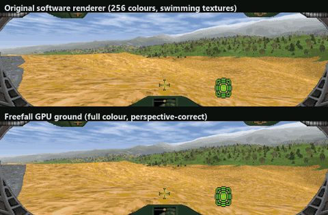
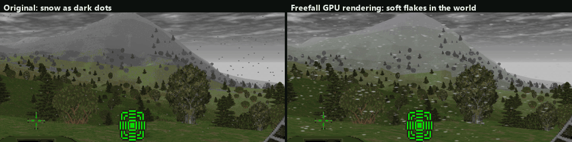

# Terra Nova: Freefall

## Purpose of this fork

**Enhancing into GPU mode with various particle and weather effects, and removing texture wobble.**

This fork moves Terra Nova's 3D world from the original software renderer onto the graphics card: full colour instead of the 256-colour palette, textures that no longer swim as you move, and room for better rain, snow, explosions, water and per-pixel effects. The original project, which this builds on, is [Cyber1on/terranova-freefall](https://github.com/Cyber1on/terranova-freefall).

### Software renderer vs GPU renderer



The same walk in Operation Seagull, frame for frame. Above: the original renderer, whose ground textures swim and shimmer as the view moves. Below: the same ground drawn by the graphics card.



Snow in Operation Sherwood. Left: the original draws snow and rain as dots and short streaks on the screen. Right: GPU rendering's weather, thousands of flakes (or rain streaks) placed in the world around you, so they stay put as you turn and walk, hidden behind hills, soft and in full colour.

| | Software renderer (original) | GPU renderer (this fork) |
|---|---|---|
| Ground texturing | Linear mapping on many polygons: textures swim and bend as you move | Perspective-correct on every polygon: textures stay put |
| Colour | 256-colour palette; light in whole steps | Full colour; light blends smoothly between the game's own light levels |
| Hiding what's behind | Drawn far to near (painter's order) | Depth buffer |
| Precision | 1990s fixed-point screen positions | Floating point |
| Where it's drawn | The processor (11–18 ms a frame at 4× 3D resolution in the built-in benchmark) | The graphics card |
| Fog | 16 levels through light tables, a square at a time | Per pixel by real distance, full colour |
| Rain and snow | Dots and short streaks on the screen | Particles in the world: rain streaks, soft drifting flakes |
| Status | Complete | **Ground (near and far), fog and weather so far.** Objects, explosions and water come next |

GPU rendering is experimental for now. It needs Direct3D 12 (DXIL shaders); Vulkan comes later. Turn it on with **O** (the Freefall options), **Display**, **GPU rendering: On** (saved as `screen_renderer=gpu` in `tnfree.ini`). It always uses full colour (True colour on). Close up it keeps the game's square texels with smoothed edges; further away it uses full-colour mipmaps with anisotropic filtering, so distant ground doesn't shimmer. The far land, which the game draws with a ray caster in screen columns, is built on the card from the map's heights, and the fog is worked out per pixel. Water, the trees, units and buildings are still the game's for now (and so still in its 256 colours). It doesn't make the game faster yet: the processor still draws the original picture alongside it, which the game's own logic reads. The speed gain comes once more of the world moves to the card.

Every change is checked against a deterministic baseline of all 39 campaign missions (`tools/baseline.py`).

**Terra Nova: Strike Force Centauri** (Looking Glass Technologies, 1996) for modern Windows, built from a complete decompilation of the game into C.

Freefall is not an emulator and does not need DOSBox. The game's program was turned back into C, function by function, each one checked against the original, and then given a new layer for video, sound and input (SDL3). Everything new is an option: with the **Classic** preset it is the DOS game.

> **This repository contains no game data.** You need your own copy of the game ([GOG](https://www.gog.com/game/terra_nova_strike_force_centauri) or [Steam](https://store.steampowered.com/app/368600)). Freefall reads the game's files, including the original `__FF.EXE`, from your installation and never changes them.

## Contents

- [Main features](#main-features)
- [Download and play](#download-and-play)
- [Controls](#controls)
- [How the game was decompiled](#how-the-game-was-decompiled)
- [How we know it is true to the original](#how-we-know-it-is-true-to-the-original)
- [How the port works](#how-the-port-works)
- [Building](#building)
- [Running the tests yourself](#running-the-tests-yourself)
- [Repository layout](#repository-layout)
- [Documentation](#documentation)
- [Credits, purpose and licence](#credits-purpose-and-licence)

## Main features

- **Runs natively on modern Windows** from your Steam or GOG copy: the whole campaign, the movies, saved games, joysticks.
- **Three presets**, chosen at the first start and changeable at any time:
  - **Classic**: the DOS game as it was.
  - **Vanilla+**: the classic look with modern controls and comfort.
  - **Freefall**: every improvement on.
- **Picture:** widescreen with 16:9 cockpits and goggles for every suit, sharp 3D up to 6 times the original resolution, 60 frames a second, longer terrain and object distances, true colour sky and fog, water reflection and ripples, sharp maps, a science-fiction infrared view, screen filters (smooth edges, CRT, scanlines).
- **Controls:** mouse look, a second controls style with its own key bindings, auto-aim, keys you can rebind, a new help screen.
- **Freefall Mod Pack included:** new cockpits with a helmet that moves as you turn, your suit's arms, new explosions and effects, trees, bushes and rocks. Every mod is one zip file in the `Mods` folder, and you can make your own: [docs/modding/](docs/modding/).
- **Music:** the soundtrack recorded as MP3 by Rich "Weeds" Nagel, SoundFont music (GeneralUser GS, and the game's own AWE32 bank), the Sound Blaster's FM music through an OPL3 emulator, General MIDI. Your own OGG or MP3 packs play too.
- **Menus and tools:** an options screen in the game's own style, a Mission Selector, a built-in benchmark, movies smoothed to 30 pictures a second.
- **48 bugs of the original game fixed**, each one documented: [docs/BUGS.md](docs/BUGS.md).

Everything Freefall changes or adds, by version: [docs/CHANGES.md](docs/CHANGES.md).

## Download and play

1. Get **tnfree-1.0.0-windows-x86.zip** from the [Releases](https://github.com/Cyber1on/terranova-freefall/releases) page.
2. Unzip it into a folder of its own that you can write to (not Program Files).
3. Double-click `tnfree.exe`. It finds a Steam or GOG installation by itself. If it finds none, it asks once for the folder of your game.

The zip holds everything: the program, the Freefall Mod Pack, the Freefall Music pack and the GeneralUser GS SoundFont. The player guide in it (`README.txt`, from [dist/README.txt](dist/README.txt)) explains every option and key.

Freefall keeps its own files next to `tnfree.exe`: saved games in `Saves`, settings in `tnfree.ini`, messages in `tnfree.log`. Nothing is written to AppData or to your game folder.

**Requirements:** Windows 10 or 11 (Windows 7 and 8 should work but are untested), and Terra Nova in its English v1.09 version (the GOG and Steam release).

> **Terra Nova Plus.** If [Terra Nova Plus](https://github.com/skw-1337/terra-nova-plus) has changed `__FF.EXE` (its HD mode does), Freefall uses the original that Terra Nova Plus keeps next to it. Your Terra Nova Plus setup keeps working.

The most useful command-line options (the full list is in the player guide):

| Option | Meaning |
|---|---|
| `--game DIR` | The folder with `__FF.EXE` and `DATA` |
| `--cd DIR` | The contents of the game CD, or the CD image, if Freefall does not find them by itself |
| `--preset classic\|vanilla+\|freefall` | Start with that preset |
| `--mission N` | A new campaign starts at mission N |
| `--bench` | Run the built-in benchmark |
| `--check` | Only load and check the original data, then exit |

Please attach `tnfree.log` when you report a problem.

## Controls

Four keys are worth knowing before anything else. Freefall also names them on the screen at the start of a mission, until you have opened the help screen once:

| Key | What it does |
|---|---|
| **H** | The help screen, in a mission: your own cockpit with each part named, and every control with the key you set for it |
| **O** | The Freefall options screen, in the menus and in missions (Alt+O is the game's own options screen) |
| **Esc** | Also opens the Freefall options in a mission, when the game has no other use for it |
| **F** | With the Advanced controls: turn your body to face where you look. The mouse only moves your head, so this is the key that makes you walk where you are looking |

There are two controls styles, chosen on the options screen (Gameplay, **Controls style**). Each keeps its own key bindings, and every key can be changed on the **Key bindings** page.

**Classic** is the original game's keyboard and mouse: the mouse moves the aiming reticle over the view, and the keys turn the body and the head. The game's manual and its own help screen describe it.

**Advanced** (in the Vanilla+ and Freefall presets) is mouse look. The aiming reticle stays at the centre of the view, and the mouse moves your head without changing where you walk. Left and right click fire and target at the reticle, as in the original.

| Key | What it does |
|---|---|
| Mouse | Look around |
| W / S | Forward / back |
| Z | Forward at half speed |
| A / D | Strafe left / right |
| Q / E | Turn left / right |
| F | Align body to head view: turn to face where you look |
| X | Gimbal mode on / off: keep turning to face where you look, as if F were held |
| Middle button | Free the pointer for the HUD / capture it again |
| Left Shift (hold) | Free the pointer while held |
| Mouse wheel | Zoom in / out |

Everything else stays on the game's own keys. The pointer is also free while the map fills the view (M): there the wheel zooms the map, and dragging with the right button moves it, as in the original game.

**The help screen (H).** With the Classic preset it is the game's own help screen. With any other settings it is Freefall's: your cockpit or goggles as they were when you pressed H, each part named with its key, and the controls of your controls style in five lists. The keys shown are the ones you set. Press H again for the game's own help screen; any other key or a click goes back to the mission.

## How the game was decompiled

This part is for people who want to study the game or do something similar with another one.

**The target.** `__FF.EXE`, English v1.09: a 32-bit DOS program in the LE format, compiled with Watcom C. No source code of Terra Nova is public.

**What was decompiled.**

| | Functions |
|---|---|
| Written as C and verified | 4,138 |
| Left as they were (third-party code, replaced by the port) | 209 |

The third-party code is the Watcom C runtime, the Miles Sound System, the Smacker movie player, the UniVBE video driver, the head-mounted display drivers and the Spaceball driver. The port replaces these with its own code, so in Freefall no routine of the original program runs.

**The order of work.** The engine libraries came first, then the game on top of them:

1. Fixed-point math, the resource file system and LZW compression.
2. The 2D graphics library (canvases, blits, texture mappers, fonts).
3. The 3D library and the EDMS physics.
4. Looking Glass support code and Terra Nova's own UI code.
5. The game itself in ten parts: foundation, objects and weapons, units, AI, terrain and the 3D view, object drawing and effects, the HUD, missions and campaign, the menus.

Terra Nova shares its engine libraries with System Shock, whose source Nightdive Studios released under the GPL. That source was a guide to the names and structure of about a quarter of the code. The rest had only the machine code, the game's own error messages and the manuals.

**How to read the result.** Each file in `src/` opens with the address range it comes from in `__FF.EXE`. A function that the original names in an error string keeps that name. The others are named `<file>_<address>` until someone understands them well enough to give them a better name. `symbols/` lists every function and data address of the original. `docs/decompilation/` holds code maps of the whole program and a report for each part.

**The rule that made it checkable.** The C keeps the original's memory layout: every global variable sits at its original address, and structures have their original shapes. That is what lets one C function be swapped in for one original function while everything else stays as it was.

## How we know it is true to the original

"It looks right" was never accepted as proof. There are four layers of checking, each one catching what the layer before it can miss.

### 1. Every function, side by side in an emulator

The original program runs in a CPU emulator (Unicorn). Our C is compiled with GCC and loaded into the same emulated memory, next to the original.

For each test case a function is called twice from exactly the same state: once at its original address and once as our C. Afterwards the two results are compared:

- the return value;
- all memory the function can touch (the data segment, the heap, every heap block, low memory);
- file positions and the contents of every file written.

Watcom passes arguments in registers in its own way, so small generated bridges ("thunks") translate between the original's calling convention and GCC's. They are generated from `symbols/`.

There are 58 test suites, one or more for each part. Together they take about 26 hours of processor time. All pass with 0 differences.

### 2. Checking that the tests can fail

A comparison that never fails proves nothing. Deliberate one-line bugs were put into the C to see whether the tests notice:

- A bug in the resource system's `ResLock` was caught 12 times.
- A sine function made wrong by one bit changed the game's state in the first frame.
- A distance function made wrong by one did **not** change the game's state in 60 frames, because the game only uses it in comparisons. This showed that whole-game runs can miss small errors, so a function's own results are also compared call by call.

### 3. The whole game, frame by frame, with the C swapped in

The original game boots in the emulator and plays a mission from scripted input. Then the same run is repeated with the decompiled functions redirected to our C (3,932 of them in one build). After every frame the complete game state of both runs is compared.

Missions 1, 2, 10 and 25 run identically, frame by frame. The harness also checks that two runs of the original are identical to each other, and that a game saved in mid-run and loaded into a fresh emulator continues identically.

### 4. The finished port against the DOS original

The first three layers check the C inside the emulator. The last one checks the real program that players run.

Freefall has a **lockstep mode** in which it sees exactly the input and timing that the emulated original sees. `verify/port_compare.py` runs both from the title screen, the way a player goes: New Game, the base, the briefing, outfitting, then about 300 frames of walking, turning, jumping and firing. At every frame it compares:

- the screen, every pixel, and the palette;
- the game's whole data area (about 1.1 MB), with pointers compared by what they point to;
- every heap block, every 50 frames.

| Mission | Frames compared | Result |
|---|---|---|
| 1 | 627 | every frame matches |
| 2 | 614 | every frame matches |
| 10 | 574 | every frame matches |
| 25 | 596 | every frame matches |

This step found real differences that the function tests could not see, and they were fixed. The most interesting one: the original divides with the CPU's `idiv` instruction and relies on the divide-error handler to give a saturated result on overflow. Plain C division never faults, so terrain went wrong 120 frames into mission 1. The port now divides the same way the original does. The full list: [docs/decompilation/frame-comparison.md](docs/decompilation/frame-comparison.md).

### Keeping it true while adding features

- **The verification build must not change.** `verify/build.sh` builds the C into a copy of the original program's layout. Its hash has to stay the same after every change to the port. Code that only the port needs sits under `#ifndef TN_WATCOM_ABI`, outside that build.
- **Every improvement is an option, off in Classic.** The Classic preset is the game that passed the comparison above.
- **Options that only change the picture are proven not to change the game.** `verify/state_compare.py` runs the same mission with the same input twice, with an option off and on, and compares the game state of both runs. Sharp 3D, widescreen and the screen filters are checked this way.
- **Bug fixes are deliberate and listed.** Where Freefall behaves differently from the DOS game on purpose, the bug has a number, a description and a reason in [docs/BUGS.md](docs/BUGS.md) (G numbers for the original game's bugs, P numbers for bugs in the port).

### Quirks of the original that were kept

The 1996 program has oddities that the C repeats on purpose, because removing them would change the game. For example, one routine reads past the end of an array and uses whatever lies after it, and another reads a stack slot that was never written. Each file in `src/` lists its own under "Quirks kept", and the comparison's allowances for them are explained in the frame comparison report.

### What is not covered

To be exact about the limits:

- The frame-by-frame comparison covers four missions for about 600 frames each, not all 39 missions from start to end.
- The third-party code (sound, movies, video driver) was replaced, not decompiled. The port's versions were written to behave the same towards the game, and the game's own state matches, but their inner workings differ.
- A few routines that only talk to DOS hardware cannot run in the emulator and were checked by reading.

## How the port works

- `src/` and `include/` hold the decompiled C. The same files build two ways: as the port (CMake) and as the verification build (`verify/build.sh`).
- The game's tables are not in this repository. At start-up the port copies them out of **your** `__FF.EXE` and fixes up the pointers in them (`port/core/image.c`).
- DOS and the third-party pieces are replaced by the port's own code on top of SDL3: video, keyboard, mouse, joystick, timer, a Miles-compatible sound mixer, FM and MIDI music, a Smacker movie decoder written for this project.
- The game still draws its 256-colour picture exactly as before. The improvements (sharp 3D, widescreen, true colour, mods) are drawn by the port beside or over that, without changing what the game computes.

More detail: [docs/PORTING.md](docs/PORTING.md).

## Building

You need CMake, Python 3 and a 32-bit GNU-compatible C compiler (MinGW-w64 GCC or Clang). Microsoft's Visual C++ compiler can't build this code yet, because it uses GNU C extensions.

**On Windows with MSYS2** (free, [msys2.org](https://www.msys2.org)): open the **MSYS2 MINGW32** shell and run:

```sh
pacman -S --needed mingw-w64-i686-gcc mingw-w64-i686-cmake mingw-w64-i686-ninja mingw-w64-i686-python git
git clone https://github.com/Cyber1on/terranova-freefall.git
cd terranova-freefall
cmake -B build -G Ninja -DCMAKE_BUILD_TYPE=Release
cmake --build build
```

**Cross-compiling on Linux** (Debian or Ubuntu: `apt install gcc-mingw-w64-i686 cmake ninja-build python3`):

```sh
cmake -B build -G Ninja -DCMAKE_BUILD_TYPE=Release -DCMAKE_TOOLCHAIN_FILE=cmake/mingw-w64-i686.cmake
cmake --build build
```

**32-bit Linux build** (a testing aid; needs `gcc-multilib`): use `-DCMAKE_TOOLCHAIN_FILE=cmake/linux-i386.cmake`.

The result is `build/tnfree.exe`, a single file with no extra DLLs. On Windows the build also makes `tnfree-rife.dll` for the optional video smoothing; `-DFREEFALL_RIFE=OFF` leaves it out.

The release zip is made by `tools/package.sh`. The Mod Pack, the Music pack and the SoundFont are not in git; the build downloads pinned copies (`tools/fetch-freefall-files.sh`, `tools/fetch-generaluser.sh`).

## Running the tests yourself

Requirements: Linux, `gcc-multilib`, Python 3 with `unicorn==2.1.4` and `capstone`, and your own copy of the game.

1. Point the scripts at your game: `export TN_GAME_ROOT="/path/to/Terra Nova"`. That folder holds `01_Game/TNOVA` (the game) and, for some frame tests, `01_Game/CD_MAPS` (the maps from the CD image).
2. Make the program image from **your** `__FF.EXE` (the script checks that it is the English v1.09 file):
   ```sh
   python3 tools/mkimage.py "$TN_GAME_ROOT/01_Game/TNOVA/__FF.EXE" build-img
   ```
3. Build and test:
   ```sh
   sh verify/build.sh
   cd verify
   python3 test_fix.py       # one library, about a minute
   python3 test_frame.py     # the whole game: mission 1 frame by frame
   ```

Every test exits with 0 when everything matches. The tests work on copies of the game files in a scratch folder, so your installation is never written to. The list of suites and how long they take: [docs/decompilation/progress.md](docs/decompilation/progress.md). Comparing the port itself with the original: [docs/PORTING.md](docs/PORTING.md).

Files made from your copy of the game (the program image, emulator snapshots, build output) must never be committed. `.gitignore` keeps them out.

## Repository layout

| Path | Contents |
|---|---|
| [`src/`](src/), `include/` | The decompiled C: the engine libraries (`fix`, `res`, `2d`, `3d`, `edms`, `lg` and others) and the game (`src/game/`, by subsystem) |
| [`port/`](port/) | The port: `core` (start-up, loader, files, platform), `original` (C for routines the decompilation kept as machine code), `video`, `audio`, `ui`, `mods`, `test` |
| [`symbols/`](symbols/) | Every function and data address of the original: name, kind, decompiled or original |
| [`verify/`](verify/) | The emulator test harness (Python and Unicorn) and the test suites |
| [`tools/`](tools/) | Build helpers: the generator for the port's data layout, the image tool, packaging |
| [`docs/`](docs/) | Documentation (below) |
| `dist/` | What goes into the release zip beside the program: the player guide, release notes, third-party licences |
| `third_party/`, `rife/`, `cmake/` | Bundled open-source components, the video smoothing module, toolchain files |

Each main folder has its own short README.

## Documentation

| Read this | For |
|---|---|
| [docs/HISTORY.md](docs/HISTORY.md) | How the project was made, step by step |
| [docs/CHANGES.md](docs/CHANGES.md) | Everything Freefall changes or adds, by version |
| [docs/BUGS.md](docs/BUGS.md) | Every bug fixed, in the original game and in the port |
| [docs/PORTING.md](docs/PORTING.md) | How the port works inside |
| [docs/modding/](docs/modding/) | Guides for mod makers: cockpit, effect, object and music packs |
| [docs/decompilation/](docs/decompilation/) | The decompilation's records: code maps, function lists, a report for each part, the frame comparison |

## Credits, purpose and licence

**Terra Nova: Freefall** was created by Nikolay "Cyberion" Ivliev. The decompilation and the port were written by Claude (Anthropic's AI model) under his direction, and tested by him in the game.

The MP3 music was synthesized by Rich "Weeds" Nagel and is included with his permission. The SoundFont is GeneralUser GS by S. Christian Collins. All bundled components and their licences: [dist/THIRD-PARTY.txt](dist/THIRD-PARTY.txt).

**Purpose.** Preservation, running the game on modern systems, study and modding. The project is non-commercial. Please buy the game: [GOG](https://www.gog.com/game/terra_nova_strike_force_centauri) · [Steam](https://store.steampowered.com/app/368600).

**Sources.** The C was written by studying the machine code of a legally owned copy of the game, together with public material: the manuals, earlier community projects, and the System Shock source released by Nightdive Studios under the GPL. No leaked or unreleased source code was used.

**Licence.** This project's own files are licensed under the **GNU General Public License v3.0**: see [LICENSE](LICENSE). `tools/le_image.py` comes from TN_SFC_improved (MIT licence). `third_party/nuked-opl3` is Nuked OPL3 by Nuke.YKT (LGPL-2.1 or later). `third_party/stb_vorbis`, `third_party/stb` (Sean Barrett) and `third_party/dr_libs/dr_mp3.h` (David Reid) are public domain or MIT. The FM music driver in `port/audio/fmsynth.c` follows ScummVM's Miles AdLib driver (GPL-3.0 or later). Terra Nova and its data belong to their rights holders.
